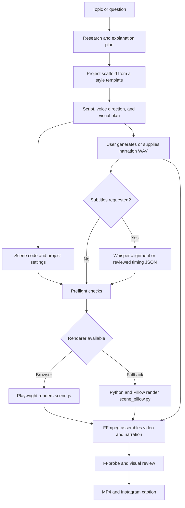
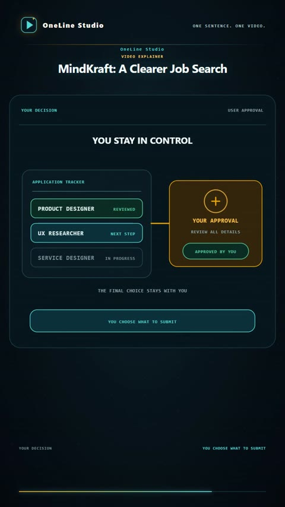

<h1 align="center">OneLine Studio</h1>

<p align="center"><strong>Turn one idea into a finished vertical video.</strong><br />Research, script, voice direction, animated scenes, narration, render, and caption in one workflow.</p>

<h2 align="center">What it does</h2>

OneLine Studio takes a topic or question and helps shape it into a short, clear video. It organizes research, writes the spoken script and voice direction, plans topic-specific visuals, and renders a portrait MP4 with an Instagram caption. The user supplies the narration WAV and chooses the TTS voice.

<p align="center">
  <video controls playsinline preload="none" width="480" poster="examples/screenshots/oneline-studio-demo-cover.jpg">
    <source src="examples/oneline-studio-demo/exports/oneline-studio-demo-v1.mp4" type="video/mp4" />
    Your browser does not support embedded video. Use the link below to play or download it.
  </video>
  <br />
  <a href="examples/oneline-studio-demo/exports/oneline-studio-demo-v1.mp4">▶ Play or download the 43-second OneLine Studio example</a>
</p>

<h2 align="center">Architecture</h2>



The CLI scaffolds projects from `templates/explainer/`. Each project keeps its research, script, voice direction, scenes, narration, timings, and exports together. Browser and Pillow renderers share the WAV-based timeline and final video assembly.

<h2 align="center">Regional-language ad example</h2>

The MindKraft sample is a promotional video for a UK job-search service, narrated in conversational in regional with natural English code-switching. Its cover, visual beats, and Instagram caption are in English.

<p align="center">
  
  <br />
  <a href="examples/mindkraft-godavari-telugu.mp4">▶ Play or download the 114-second Godavari Telugu ad</a>
</p>

<h2 align="center">How to use it</h2>

<h3 align="center">In ChatGPT Workspace</h3>

Give OneLine Studio a topic or question in one sentence. You can also request a title, brand, logo, visual style, script language, or subtitles. The handoff provides the spoken script and its voice direction.

Use any TTS tool or free account that can export a WAV, then provide that recording. If you prefer an internal TTS option, approve a check for availability first. The project uses the supplied WAV as its narration and timing source.

<h3 align="center">From a local computer</h3>

Install dependencies and create a project from a sentence:

```powershell
npm.cmd install
npm.cmd run new -- "Why does a database index make lookups faster?"
```

The command creates a project under `projects/`. Add verified research, a completed script and voice direction, the narration WAV, and topic-specific scenes before rendering. You can set a title, hook, or brand as options:

```powershell
npm.cmd run new -- --topic "Why does a database index make lookups faster?" --title "Database Indexes" --hook "Find the row faster" --brand "Example Studio"
```

Set script and narration languages with ISO language codes. `auto` lets subtitle alignment detect the language of the WAV:

```powershell
npm.cmd run new -- --topic "Explain this idea" --script-language ta --narration-language ta
npm.cmd run new -- --topic "Explain this idea" --script-language es --narration-language es --captions phrase --caption-language en
```

On-video subtitles are off by default. Use `--captions phrase` for phrase subtitles or `--captions karaoke` for same-language word highlighting. Translated subtitles use phrase timing. Whisper is not needed when subtitles are off.

Check the project, render, and review the MP4:

```powershell
npm.cmd run preflight -- projects/my-concept
node projects/my-concept/render-v1.mjs
node projects/my-concept/review-v1.mjs
```

The output is written to the project's `exports/` folder. Include the MP4 and Instagram caption in the final delivery. In macOS and Linux shells, use `npm` instead of `npm.cmd`.

<h3 align="center">Install rendering dependencies</h3>

```powershell
python -m pip install -r requirements-render-pillow.txt
```

Playwright's Chromium is optional. Install it with `npm.cmd run browser:install`. If a supported browser cannot launch, `renderer: "auto"` uses Pillow. `requirements-align.txt` is optional and only needed for automatic Whisper subtitle alignment. FFmpeg and FFprobe are required for video assembly and inspection. See [the rendering guide](docs/rendering.md).

<h2 align="center">Tools used</h2>

| Tool | What it does here |
| --- | --- |
| Node.js and JavaScript ES modules | Scaffold projects, check the environment, and coordinate rendering. |
| HTML, CSS, JavaScript, and Playwright | Build animated browser scenes and capture them. |
| Python and Pillow | Draw 2D scenes when browser rendering is unavailable. |
| FFmpeg and FFprobe | Assemble frames with narration, encode the MP4, and inspect media properties. |
| Whisper and PyTorch (optional) | Align narration to phrases or words when subtitles are requested. |
| User-selected TTS tool | Generate the narration WAV. OneLine Studio does not bundle a TTS provider. |

<h2 align="center">Repository layout</h2>

| Path | Purpose |
| --- | --- |
| `scripts/` | Project scaffolder and preflight check. |
| `templates/<style>/` | Reusable project and visual templates. |
| `render-engine/` | Shared browser and Pillow renderers. |
| `docs/` | Rendering and multilingual narration guides. |
| `projects/<slug>/` | Local project files. Ignored by Git by default. |
| `examples/` | Tracked videos and sample project source. |
| `AGENTS.md` | Project authoring and delivery rules. |

<h2 align="center">License</h2>

OneLine Studio is released under the MIT License. See [`LICENSE`](LICENSE). Read [`AGENTS.md`](AGENTS.md) before starting a project.
