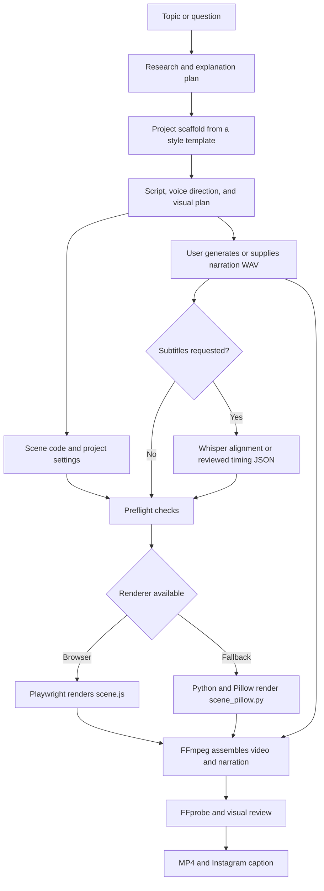

# OneLine Studio

**Turn one idea into a finished vertical video.** OneLine Studio helps research a topic, write a spoken script, plan animated scenes, and render an MP4 with an Instagram caption. It works in ChatGPT Workspace or from a local computer.

## What it does

Start with a topic or question. OneLine Studio turns it into a short explanation with a concrete example, a script and voice direction, animated visuals, and a caption for social posting. It uses a narration WAV supplied by the user, so the user can choose the TTS service and voice.

The default video is under two minutes, portrait format, English on-screen text, and no on-video subtitles. The spoken narration follows the requested language. Other visual and caption languages can be changed when requested.

## Example

**MindKraft: A clearer UK job search** uses conversational Godavari Telugu with natural English code-switching in the narration. The cover, visual beats, and Instagram caption stay in English.

[Watch or download the 114-second sample video](examples/mindkraft-godavari-telugu.mp4).

| Opening cover | User approval scene |
| --- | --- |
|  |  |

## Architecture



The CLI copies `templates/explainer/` into a project. Projects keep their research, script, voice direction, scenes, narration, timings, and exports together. The browser and Pillow routes share the WAV-based timeline and final FFmpeg assembly.

## How to use it

### In ChatGPT Workspace

Give OneLine Studio a topic or question in one sentence. You can also request a title, brand, logo, visual style, script language, or subtitles. The handoff provides the spoken script and its voice direction.

Use any TTS tool or free account that can export a WAV, then provide that recording. If you prefer an internal TTS option, approve a check for availability first. The project uses the supplied WAV as its narration and timing source.

### From a local computer

Install the project dependencies and create a project from a sentence:

```powershell
npm.cmd install
npm.cmd run new -- "Why does a database index make lookups faster?"
```

The command creates a folder under `projects/`. Add the researched script, voice direction, narration WAV, and topic-specific scenes before rendering. You can optionally set the title, hook, brand, or logo:

```powershell
npm.cmd run new -- --topic "Why does a database index make lookups faster?" --title "Database Indexes" --hook "Find the row faster" --brand "Example Studio"
```

Set the spoken-script and WAV languages with ISO language codes. `auto` lets subtitle alignment detect the WAV language:

```powershell
npm.cmd run new -- --topic "Explain this idea" --script-language ta --narration-language ta
npm.cmd run new -- --topic "Explain this idea" --script-language es --narration-language es --captions phrase --caption-language en
```

Video subtitles are off by default. Use `--captions phrase` for phrase subtitles or `--captions karaoke` for same-language word highlighting. Translated subtitles use phrase timing. Do not run Whisper just for timing when subtitles are off.

Check the project, render, and create review frames:

```powershell
npm.cmd run preflight -- projects/my-concept
node projects/my-concept/render-v1.mjs
node projects/my-concept/review-v1.mjs
```

The final MP4 is written to the project's `exports/` folder. Include it with the Instagram caption when delivering the finished video.

### Install rendering dependencies

```powershell
npm.cmd install
python -m pip install -r requirements-render-pillow.txt
```

Playwright's Chromium is optional. Install it with `npm.cmd run browser:install`. If a supported browser cannot launch, `renderer: "auto"` uses Pillow. `requirements-align.txt` is optional and is only needed for automatic Whisper subtitle alignment. FFmpeg and FFprobe are required for video assembly and inspection.

On macOS or Linux, use `npm` instead of `npm.cmd`.

## Tools used

| Tool | What it does here |
| --- | --- |
| Node.js and JavaScript ES modules | Scaffold projects, check the environment, and coordinate rendering. |
| HTML, CSS, JavaScript, and Playwright | Build animated browser scenes and capture them. |
| Python and Pillow | Draw 2D scenes when browser rendering is unavailable. |
| FFmpeg and FFprobe | Assemble frames with narration, encode the MP4, and inspect media properties. |
| Whisper and PyTorch (optional) | Align narration to phrases or words when subtitles are requested. |
| User-selected TTS tool | Generate the narration WAV. OneLine Studio does not bundle a TTS provider. |

## Repository layout

| Path | Purpose |
| --- | --- |
| `scripts/` | Project scaffolder and preflight check. |
| `templates/<style>/` | Reusable project and visual templates. |
| `render-engine/` | Shared browser and Pillow renderers. |
| `docs/` | Rendering and multilingual narration guides. |
| `projects/<slug>/` | Local project files. This folder is ignored by Git by default. |
| `examples/` | Tracked video examples and sample project source. |
| `AGENTS.md` | Project authoring and delivery rules. |

OneLine Studio is released under the MIT License. See [`LICENSE`](LICENSE). Read [`AGENTS.md`](AGENTS.md) before starting a project.
