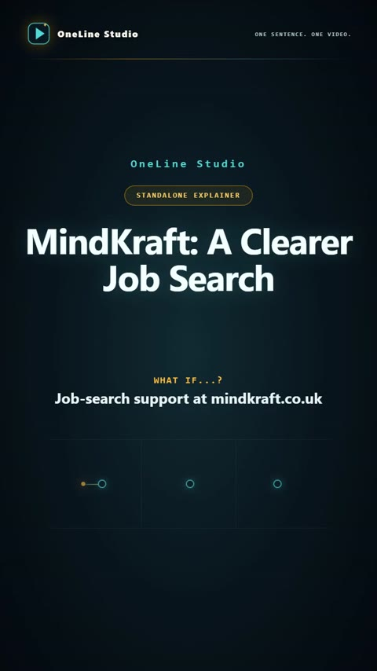
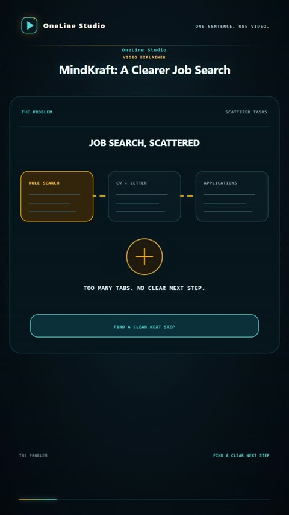
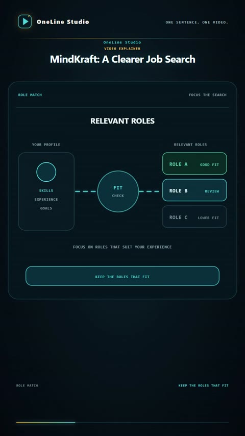
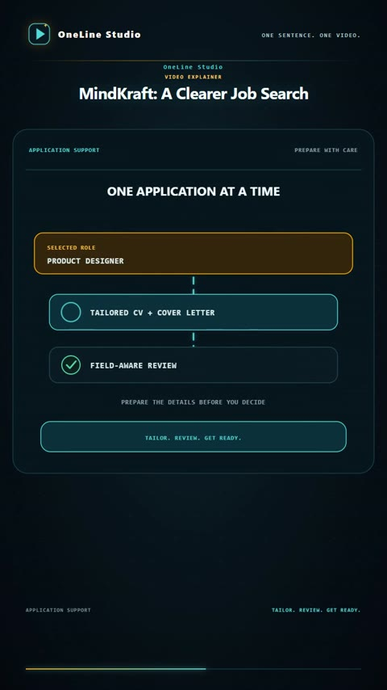
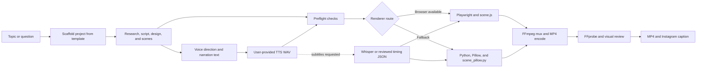

# OneLine Studio

**Turn one sentence into a researched, scripted, narrated, animated vertical video.** OneLine Studio creates a complete video project from a topic or question. It runs in ChatGPT Workspace and on ordinary PCs.

## Start with one sentence

Give OneLine Studio a topic or question in a sentence. It can infer the title and hook, use OneLine Studio branding, select a matching style, and build the project. You can also choose a title, brand, logo, or script language.

To scaffold a project from a terminal:

```powershell
npm.cmd install
npm.cmd run new -- "Why does a database index make lookups faster?"
```

Optional overrides:

```powershell
npm.cmd run new -- --topic "Why does a database index make lookups faster?" --title "Database Indexes" --brand "Example Studio" --logo "C:\path\to\logo.png"
```

Set spoken-script and supplied-narration languages with ISO codes. `auto` lets Whisper detect narration language during subtitle alignment. On-video subtitles stay off unless requested:

```powershell
npm.cmd run new -- --topic "Why does a database index make lookups faster?" --script-language ta --narration-language ta
npm.cmd run new -- --topic "Why does a database index make lookups faster?" --script-language es --narration-language es --captions phrase --caption-language en
npm.cmd run new -- --topic "Why does a database index make lookups faster?" --captions karaoke
```

The earlier `<slug> "Title" "Cover hook"` command form remains supported.

## Production flow

1. Start from the user's sentence and identify the viewer and one useful idea.
2. Verify technical claims against authoritative sources and save links and caveats in `research.md`.
3. Write the narration directly in the requested language and style, with a concrete example. Provide the script and a separate voice direction.
4. Choose a matching visual template, create animated scenes, and keep on-screen copy in English by default.
5. Add the approved narration WAV, time the scenes to it, render, and review the MP4.
6. Deliver the video with its complete Instagram caption.

Keep videos at or below two minutes unless the user approves a longer runtime. Phrase subtitles are the default when subtitles are requested. Use karaoke highlighting only when subtitle text is in the spoken language and fresh word timings exist for the current recording. For translated subtitles, use phrase timing. Do not run Whisper just for timing when subtitles are off.

## Narration handoff

The handoff gives the user a script and voice direction. They can use any TTS service or free account that supports WAV export, then provide the generated recording. Save the confirmed file as `assets/audio/narration.wav`; the renderer uses that exact recording as the video clock.

If the user prefers an internal TTS option, ask for approval before checking whether one is available in the active environment. Do not assume an internal service exists or name a provider before checking.

When requested subtitles need alignment, pass the known `narrationLanguage` or use `auto`. If automatic recognition fails or does not match the recording, use reviewed timing JSON for that exact WAV. Never reuse timings from another recording. If the supplied WAV differs from the narration block, add its exact transcript under `## Spoken transcript for timing` when subtitle timing is needed.

## Render and review

Run the project preflight, render, and review scripts from the workspace root:

```powershell
npm.cmd run preflight -- projects/my-concept
node projects/my-concept/render-v1.mjs
node projects/my-concept/review-v1.mjs
```

The browser renderer is used when Playwright can launch Chromium, Edge, or Chrome. Otherwise, `renderer: "auto"` falls back to the Pillow 2D renderer. Both routes use WAV duration and scene beats for timing. FFmpeg and FFprobe are required to assemble and inspect the MP4.

Install core dependencies when the environment allows it:

```powershell
npm.cmd install
python -m pip install -r requirements-render-pillow.txt
```

`requirements-align.txt` is optional and needed only for automatic Whisper alignment. To install Playwright's Chromium:

```powershell
npm.cmd run browser:install
```

If dependencies cannot be installed, use available system FFmpeg/FFprobe and Pillow. `npm.cmd run preflight` reports which renderer is ready. Use `npm` instead of `npm.cmd` in macOS or Linux shells. See [the rendering guide](docs/rendering.md).

Review the exact opening frame, cover handoff, scene transitions, dense diagrams, audio sync, and final hold. Keep temporary images in `exports/review/` and remove them after review.

## Visual and publishing defaults

- 720 x 1280 portrait video at 30 fps with AAC audio.
- OneLine Studio logo and wordmark by default. Custom branding is opt-in.
- Topic-specific visual metaphors and purposeful animated state changes.
- English cover, visual labels, and Instagram caption by default. Narration follows the requested language.
- No on-video subtitles unless requested.
- Instagram caption target: 1,500-2,000 characters including spaces and hashtags, under 2,200 characters, with up to five relevant hashtags.
- Include both the MP4 and complete caption in the final delivery.

## Examples

### MindKraft: A clearer UK job search

This sample uses conversational Godavari Telugu and natural English code-switching in the narration. The cover, visual beats, and Instagram caption stay in English, with on-video subtitles off.

[Watch or download the 114-second MP4](examples/mindkraft-godavari-telugu.mp4).

## Screenshots

Frames from the sample video, from opening to user approval:

| Cover · 0:00 | Scattered search · 0:17 |
| --- | --- |
|  |  |

| Role matching · 0:31 | Application preparation · 1:00 |
| --- | --- |
|  |  |

| User approval · 1:27 |
| --- |
|  |

## Process and architecture



Projects are scaffolded from `templates/explainer/` by `scripts/new-explainer.mjs`. `scripts/preflight.mjs` checks the project and available render routes. The render entry point selects the browser or Pillow path, while the supplied WAV sets the video timeline. Whisper timing is optional and used only when requested subtitles need it.

## Technologies

| Layer | Technologies | Role |
| --- | --- | --- |
| Project tooling | Node.js, JavaScript ES modules | Project scaffolding, preflight, and render orchestration |
| Browser scenes | HTML, CSS, JavaScript, Playwright | Responsive scene animation and browser capture |
| Fallback scenes | Python, Pillow | 2D frame rendering when browser rendering is unavailable |
| Video assembly | FFmpeg, FFprobe | MP4 encoding, narration muxing, and media inspection |
| Optional subtitle timing | Whisper, PyTorch | Phrase or word timing from the current narration WAV |
| Narration audio | User-provided WAV from a chosen TTS tool | Keeps TTS choice with the user; no TTS provider is bundled |

## Workspace map

| Path | What it contains |
| --- | --- |
| `projects/<slug>/` | Local scripts, research, scenes, narration, timing, review, and exports. Ignored by Git by default. |
| `examples/` | Small tracked video examples and sample project source. |
| `templates/<style>/` | Reusable visual and production styles. |
| `render-engine/` | Shared browser and Pillow rendering tools. |
| `scripts/` | Project scaffolder and environment preflight. |
| `AGENTS.md` | Project authoring and delivery rules. |

## License

OneLine Studio is released under the MIT License. See [`LICENSE`](LICENSE).

Read [`AGENTS.md`](AGENTS.md) before starting a project.
